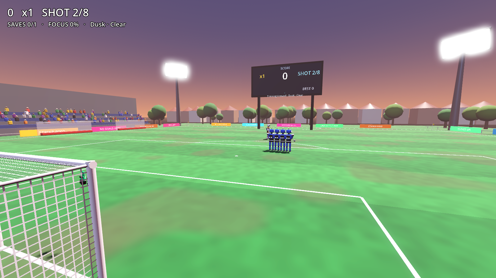

# RoboKeeper VR

**Stand in goal and save shots from a football-mad robot, using your hands.** It's a free VR game for PC VR: PSVR2 (via the PC adapter + SteamVR), Meta Quest (Link / Air Link / Virtual Desktop), Valve Index, Vive, Pico and any other OpenXR headset.

You can play it **standing still or seated**. You never need to take a step.

## Download & play
1. Go to **[Releases](../../releases/latest)** and download `RoboKeeperVR-vX.Y.Z-windows.zip`.
2. Unzip it anywhere.
3. Start **SteamVR**, or your headset's OpenXR runtime. For PSVR2, make sure SteamVR is set as the OpenXR runtime: *SteamVR → Settings → OpenXR*.
4. Run **RoboKeeperVR.exe**.

First time? Punch **TUTORIAL**, then **CALIBRATE REACH** so the goal fits your arms.

## Controls
| Action | How |
|---|---|
| Save | Get a glove (or your head!) in the way |
| Dive | Fling your arm out fast: the glove stretches further |
| Catch | Hold **grip** as the ball hits your palm. Two hands are safer. |
| Throw | Release **grip** while swinging. Hit the robot for a bonus! |
| Punch | Clench your fist (grip) and punch through the ball |
| Slow-mo | When FOCUS is full, squeeze **both triggers** |
| Pause | **Menu** button |
| Recenter | **B / Y** button, or the RECENTER button in the menu |

With no headset, the game runs in desktop mode: the mouse moves the gloves, the left button grips, Space triggers slow-mo and Esc opens the menu.

## Modes
**Career** (12 levels, star ratings, unlockable gloves) · **Arcade** (waves, lives and boss robots) · **Practice** · **Shootout** (10 penalties) · **2 Player** (VR keeper vs a striker on the PC keyboard or gamepad) · **Tutorial**

## Read the robot
Its eyes and the ball trail show what's coming: **orange** power · **yellow** low drive · **purple** curler · **cyan** chip · **blue** free kick · **green** bouncer · **pink** Panenka · **red** cannon · **white** knuckleball · **gold** = ×3 points.

Watch out for stutter-steps and fake looks, rebound strikers if you parry into the middle, and boss robots every 5 waves.

## Changelog
See [CHANGELOG.md](CHANGELOG.md).
